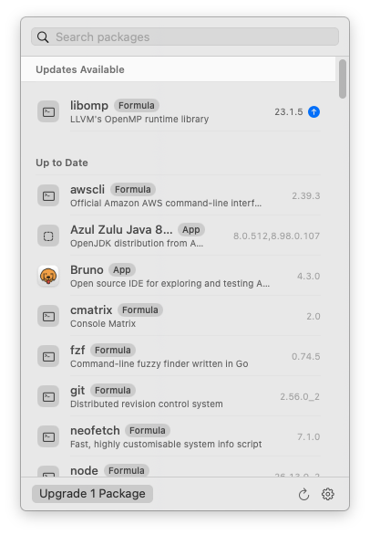

<p align="center">
  
</p>

<h1 align="center">Gingerbrew</h1>

<p align="center">
  <strong>Homebrew, one click away in your menu bar.</strong><br>
  A minimal, native macOS app to browse, install, update and remove your Homebrew packages.
</p>

<p align="center">
  <a href="https://github.com/luanpanno/gingerbrew/releases/latest"></a>
  <a href="https://github.com/luanpanno/gingerbrew/actions/workflows/ci.yml"></a>
  
  
  <a href="https://github.com/luanpanno/gingerbrew/releases"></a>
  <a href="LICENSE"></a>
</p>

<p align="center">
  <a href="#-install">Install</a> •
  <a href="#-features">Features</a> •
  <a href="#-usage">Usage</a> •
  <a href="#-faq">FAQ</a> •
  <a href="#-build-from-source">Build</a> •
  <a href="#-contributing">Contributing</a>
</p>

<p align="center">
  
</p>

---

## ✨ Features

| | |
| --- | --- |
| 📦 **Everything you installed** | Your apps and formulae in one list, each tagged **App** or **Formula**. Dependencies Homebrew pulled in sit in their own collapsible group. |
| ⬆️ **Updates at a glance** | Outdated packages float to the top with the new version, the menu bar icon shows how many are waiting, and **Upgrade All** takes care of them. |
| 🔍 **Search everything** | Filters what you have and recommends what you don't, from the full Homebrew catalogue of formulae and casks. |
| 📋 **Package details** | Icon, description, developer, version, license, website, install date and caveats. |
| 🧹 **Clean removal** | Uninstall, or **Remove Completely**: `--zap` for apps (deletes their data too) and every installed version for formulae. |
| 🌳 **Dependencies both ways** | See what a package needs and what needs it, and jump between them. |
| ⏰ **Background checks** | Runs `brew update` every 1, 6, 12 or 24 hours, with a notification when something new is available. |
| 🖱️ **Right-click menu** | Right-click the menu bar icon for Open Gingerbrew, Settings, About and Quit. |
| 📜 **Live output** | Watch `brew` work with a spinner and an expandable log; failures open the log automatically. |
| 🚀 **Launch at login** | Start with your Mac, quietly, in the menu bar. |

Built with native SwiftUI and AppKit components, so it looks and feels like part of macOS, in light and dark mode.

## 📥 Install

**Requirements:** macOS 14 Sonoma or later, and [Homebrew](https://brew.sh).

### With Homebrew (recommended)

```bash
brew install --cask luanpanno/tap/gingerbrew
```

Update it later like any other cask with `brew upgrade --cask gingerbrew`, or right from Gingerbrew itself.

### Manually

1. Download the latest `.dmg` from [**Releases**](https://github.com/luanpanno/gingerbrew/releases/latest).
2. Open it and drag **Gingerbrew** to **Applications**.
3. The first time, right-click Gingerbrew and choose **Open**. Releases aren't notarized yet, so macOS asks once. Or run:

   ```bash
   xattr -dr com.apple.quarantine /Applications/Gingerbrew.app
   ```

## 🧭 Usage

| To | Do this |
| --- | --- |
| Open the panel | Click the mug in the menu bar |
| See the menu | Right-click (or Control-click) the mug |
| Find a package | Start typing; <kbd>Esc</kbd> clears the search |
| See details | Click any package |
| Go back | <kbd>⌘</kbd> <kbd>[</kbd> or the Back button |
| Check for updates | <kbd>⌘</kbd> <kbd>R</kbd> or the ↻ button |
| Open Settings | <kbd>⌘</kbd> <kbd>,</kbd> or the gear menu |
| Quit | <kbd>⌘</kbd> <kbd>Q</kbd> or the gear menu |

When the mug turns solid and shows a number, that many packages have updates.

### Settings

- **Launch at login**
- **Check for updates:** every 1, 6 (default), 12 or 24 hours, or never
- **Include apps that update themselves:** also lists updates for casks like browsers that normally update on their own (`brew outdated --greedy`)
- **Show notifications**
- **Catalogue:** when the search catalogue was last downloaded, with a button to refresh it

## ❓ FAQ

<details>
<summary><strong>Why are some packages under “Dependencies”?</strong></summary>

Homebrew records whether you asked for a formula or it came along because another package needs it. Gingerbrew lists what you asked for first and collapses the rest. Apps (casks) are always installed on purpose, so they're never in that group.
</details>

<details>
<summary><strong>Why does it ask for my password?</strong></summary>

Some casks run installers that need administrator rights. Gingerbrew shows a native macOS password dialog and hands the password straight to `sudo`. It's never stored or sent anywhere.
</details>

<details>
<summary><strong>An app with its own updater doesn't show its update.</strong></summary>

Casks marked `auto_updates` (most browsers, for example) are skipped by default, the same as `brew outdated`. Turn on **Include apps that update themselves** in Settings to see them.
</details>

<details>
<summary><strong>Does Gingerbrew send any data anywhere?</strong></summary>

No. It runs your local `brew` and downloads the public package catalogue from <code>formulae.brew.sh</code> once a day for search. There's no analytics or tracking.
</details>

<details>
<summary><strong>Why isn't it on the Mac App Store?</strong></summary>

App Store apps must be sandboxed, and a sandboxed app can't run `brew`.
</details>

<details>
<summary><strong>It says Homebrew isn't installed, but it is.</strong></summary>

Gingerbrew looks for `brew` in `/opt/homebrew/bin` (Apple silicon) and `/usr/local/bin` (Intel). If yours lives somewhere else, please [open an issue](https://github.com/luanpanno/gingerbrew/issues).
</details>

## 🛠 Build from source

You only need the Xcode Command Line Tools (`xcode-select --install`); full Xcode works too.

```bash
git clone https://github.com/luanpanno/gingerbrew.git
cd gingerbrew
scripts/build-app.sh            # builds dist/Gingerbrew.app
open dist/Gingerbrew.app
```

| Command | What it does |
| --- | --- |
| `scripts/test.sh` | Runs the unit tests |
| `swift run Gingerbrew` | Runs without bundling (no notifications or login item) |
| `DMG=1 UNIVERSAL=1 scripts/build-app.sh` | Builds a universal `.dmg` in `dist/` |
| `swift scripts/make-icon.swift` | Regenerates `Support/AppIcon.icns` |

To work in Xcode, open `Package.swift`.

### How it works

```
Sources/GingerbrewCore   brew wrapper, JSON parsing, search ranking, catalogue cache
Sources/Gingerbrew       SwiftUI menu bar app (MenuBarExtra, window style)
Support/                 Info.plist, app icon, sudo password helper
scripts/                 bundling, signing, .dmg, tests, icon
packaging/               Homebrew cask template
```

- Installed packages come from `brew info --json=v2 --installed`; update availability from `brew outdated --json=v2`.
- Search uses a trimmed copy of `formulae.brew.sh/api/{formula,cask}.json`, cached in `~/Library/Caches/com.luanpanno.gingerbrew` and refreshed daily.
- Commands run with `HOMEBREW_NO_AUTO_UPDATE` and colours off, and their output streams live into the panel.
- `SUDO_ASKPASS` points to a small script that shows the native password dialog.

### Releasing

1. Tag and push, for example `git tag v0.2.0 && git push --tags`. The release workflow builds a universal `.dmg`, named after the tag, and publishes it with its SHA-256 in the notes.
2. Update `version` and `sha256` in the tap's `Casks/gingerbrew.rb` (template in [`packaging/gingerbrew.rb`](packaging/gingerbrew.rb)).

Signing and notarization turn on automatically once the repository secrets listed in [`.github/workflows/release.yml`](.github/workflows/release.yml) are added.

## 🤝 Contributing

Issues and pull requests are welcome.

- Found a bug or have an idea? [Open an issue](https://github.com/luanpanno/gingerbrew/issues).
- Before sending a pull request, run `scripts/test.sh` and make sure `scripts/build-app.sh` succeeds.
- Gingerbrew aims to stay small and native: standard macOS controls, no third-party dependencies.

## 📄 License

[MIT](LICENSE) © Luan Panno

<p align="center"><sub>Not affiliated with the Homebrew project.</sub></p>
